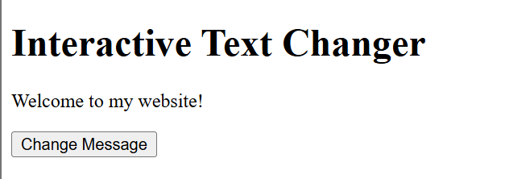
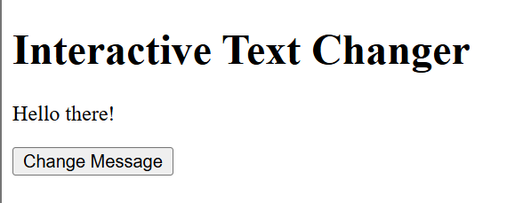
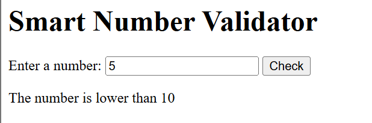
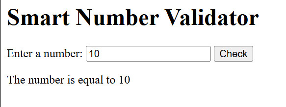
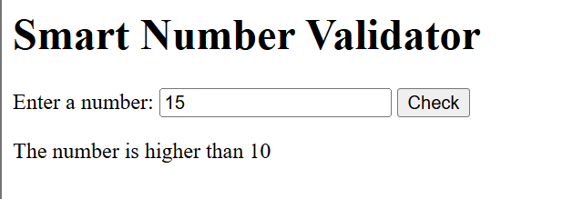
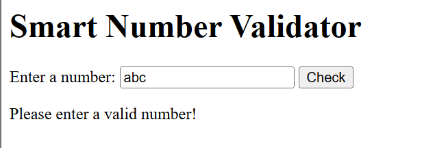
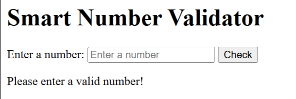
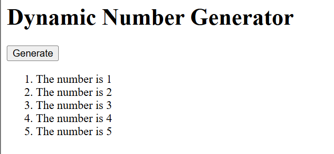

# BIC21203 Web Development - Lab 4a

## Student Information
Name: CHING PEI YEE
Student ID: AI240139
Course: BIC21203 Web Development
Lab: Lab 4a - Client-Side Scripting (JavaScript)
Academic Session: 2026/2027

## Introduction
This lab focuses on client-side scripting using
JavaScript. It covers functions, event handling,
conditional statements, loops, input validation,
and DOM manipulation.

## Question 1: Interactive Text Changer
This webpage changes the paragraph text from
"Welcome to my website!" to "Hello there!"
when the Change Message button is clicked.

### How to Run
1. Open the Q1 folder.
2. Open index.html using Live Server.
3. Click the Change Message button.
4. Observe the updated paragraph.

### Output Screenshots

## Question 2: Smart Number Validator
This webpage validates user input and compares
the entered number with 10 using conditional
statements.

### How to Run
1. Open the Q2 folder.
2. Open index.html using Live Server.
3. Enter a number and click Check.
4. Observe the validation result.

### Output Screenshots

## Question 3: Dynamic Number Generator
This webpage uses a for loop and DOM methods
to generate an ordered list of numbers from
1 to 5 without duplicating existing items.

### How to Run
1. Open the Q3 folder.
2. Open index.html using Live Server.
3. Click the Generate button.
4. Click Generate again to verify that
   no duplicate items appear.

### Output Screenshots

## Conclusion
This lab improved my understanding of JavaScript
functions, event listeners, conditional statements,
loops, and DOM manipulation.
